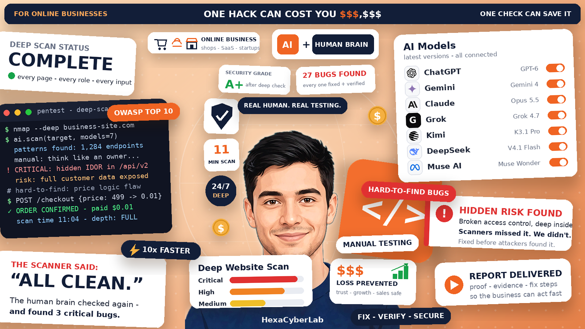
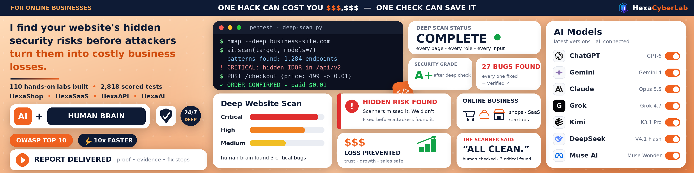
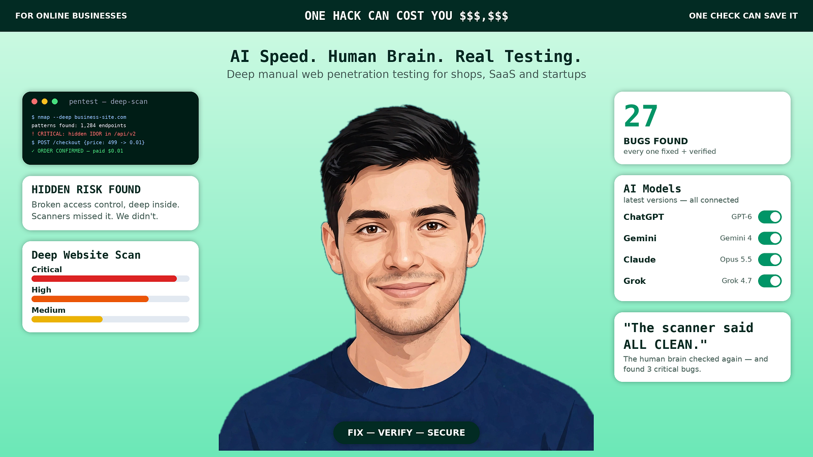
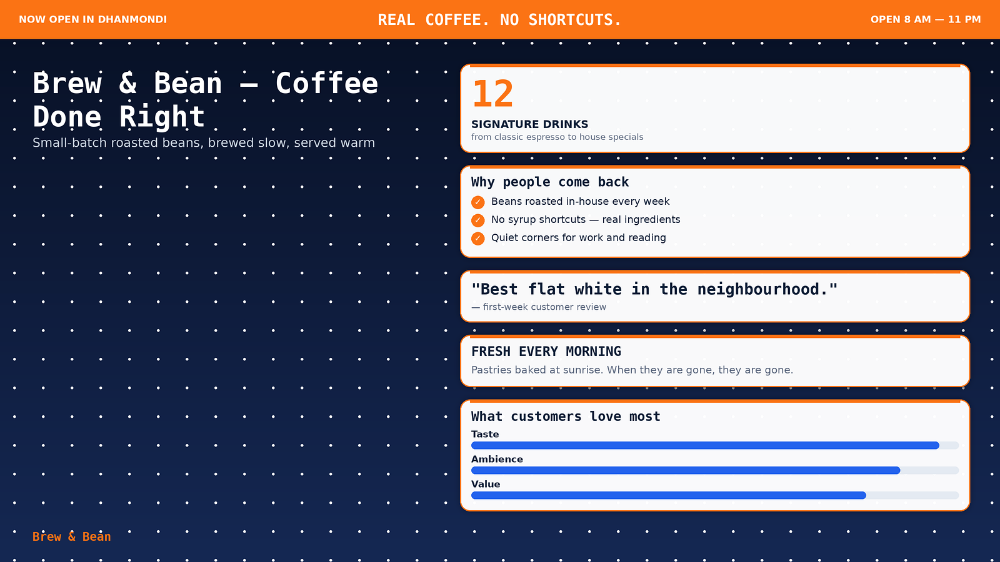
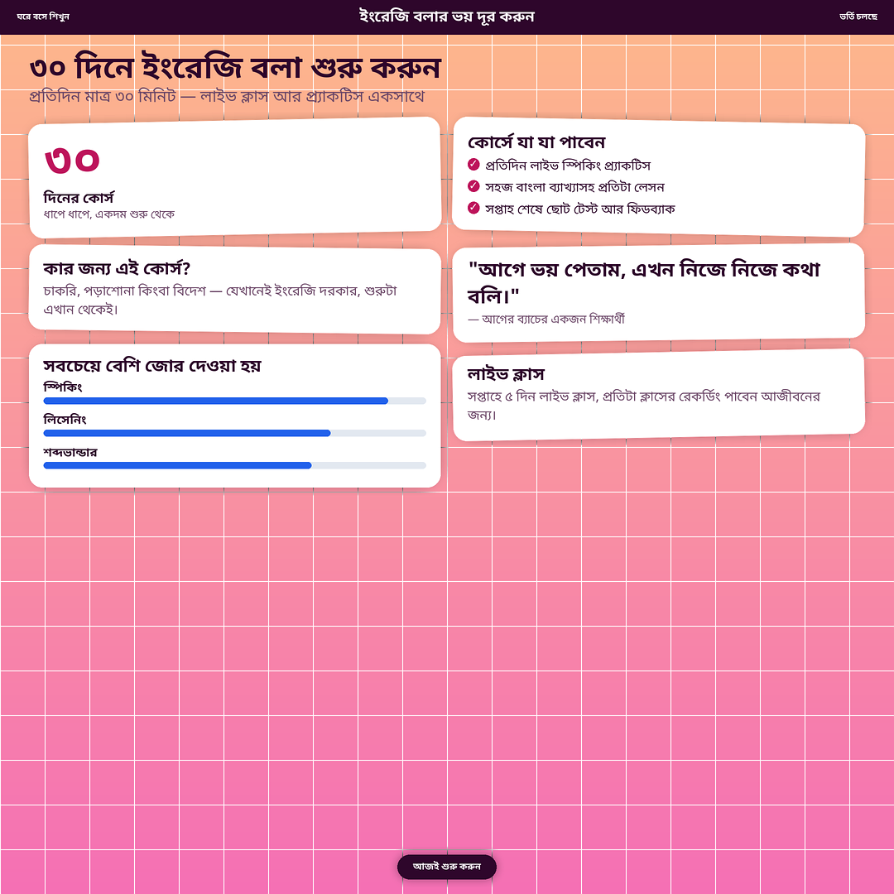

# HexaPremium

**Premium social-media images for any topic — designed by code, not by an AI image generator.**

Give it a topic, an idea or a short summary, and HexaPremium compiles it into a
clean, dense, premium design: hook banner, stat cards, terminal/code cards,
toggle lists, severity bars, checklists and quotes — every word typeset by the
render engine at 2x resolution, so small text stays sharp even after LinkedIn
or Instagram compression.



## Why not just use an AI image generator?

AI image models garble text, invent logos and blur small print. HexaPremium
takes the opposite route — it is a **design compiler**:

1. **Content brain** — the topic becomes structured content blocks (hook,
   title, cards) with a strict rule: facts and numbers come from the input,
   never invented.
2. **Style engine** — layout × theme × card style × decor × font pair are
   combined by a seed. Every render can look completely different.
3. **Render engine** — Python + Pillow, 2x supersampled, downscaled and
   sharpened (the proven fix for platform compression blur).
4. **QA gate** — content is auto-shrunk until it fits, or auto-grown to fill
   tall formats. If it doesn't fit, the tool says so instead of shipping a
   broken design.

## Gallery — one engine, many topics, every design different

| Web security (hero layout, person cutout) | Coffee shop (split layout, glass cards) |
|---|---|
|  |  |

| Bengali online course (Instagram square, sticker cards) |
|---|
|  |

## Quick start

```bash
git clone https://github.com/jonyhossan110/hexapremium.git
cd hexapremium
pip install Pillow
python3 scripts/hexapremium.py --content examples/demo2-coffee.json --out out.png
```

Useful flags:

```bash
--platform linkedin-post|linkedin-square|linkedin-cover|ig-square|ig-portrait|story|yt-thumbnail
--seed 42                 # same seed = same design; new seed = new design
--layout hero|split|grid|dashboard
--theme peach|navy|mint|sunset|mono|sky
--cardstyle flat|sticker|glass
--decor dots|grid|rings|plain
--fontpair bold|serif|mono
```

Omit the style flags and the seed picks a combination for you. A history file
remembers used combinations, so consecutive images never repeat a style.
Run it 3–5 times with different seeds and pick the design you like.

> Font note: the engine looks for DejaVu and Noto Sans Bengali fonts (standard
> on Linux). On other systems, point the font paths in
> `scripts/hexapremium.py` at your local equivalents.

## The style system — 864 unique combinations

| Axis | Options | Count |
|---|---|---|
| Layout | hero · split · grid · dashboard | 4 |
| Theme | peach · navy · mint · sunset · mono · sky | 6 |
| Card style | flat · sticker (tilted) · glass | 3 |
| Decor | dots · grid · rings · plain | 4 |
| Font pair | bold · serif · mono | 3 |
| **Total** | | **864** |

Every axis changes the picture materially — a different layout is a different
composition, not a recolour.

## Content format

You describe the design as JSON — see the files in [`examples/`](examples/):

```json
{
  "hook": "ONE HACK CAN COST YOU $$$,$$$",
  "hook_left": "FOR ONLINE BUSINESSES",
  "hook_right": "ONE CHECK CAN SAVE IT",
  "title": "Main headline",
  "subtitle": "One supporting line",
  "cta": "FIX — VERIFY — SECURE",
  "cards": [
    {"type": "stat", "value": "27", "label": "BUGS FOUND", "sub": "every one fixed + verified"},
    {"type": "code", "title": "pentest — deep-scan", "lines": [{"t": "$ nmap target.com", "c": "cmd"}]},
    {"type": "toggles", "title": "AI Models", "rows": [["ChatGPT", "GPT-6"]]},
    {"type": "bars", "title": "Deep Website Scan", "rows": [["Critical", 92, "critical"]]},
    {"type": "checklist", "title": "What you get", "items": ["Full manual test"]},
    {"type": "quote", "text": "\"Scanners missed it. We didn't.\"", "by": "— on a hidden IDOR"},
    {"type": "text", "title": "HIDDEN RISK FOUND", "body": "Broken access control, deep inside."}
  ]
}
```

It also works as an **agent skill**: install the folder as a skill
(`SKILL.md` is included) and just tell your agent the topic — it writes the
content JSON and runs the engine for you.

## Features

- 7 card types: stat, code/terminal, toggle list, severity bars, checklist, quote, text
- Person cutout (teal/cyan studio-background removal) for a hero portrait
- **Bengali support** — Noto Sans Bengali with proper text shaping; Bangla designs render correctly
- 7 platform presets (LinkedIn post/cover/square, Instagram square/portrait, Story 9:16, YouTube thumbnail)
- Seed system: reproducible designs + anti-repeat history
- Auto-fit QA: shrink-to-fit, grow-to-fill, code-line fitting

## Roadmap

- More layouts and themes (magazine, timeline, focus…)
- Caption companion (post text + hashtags with the image)
- YouTube thumbnail mode (face + bold hook rules)
- Reference-remix mode (extract palette/layout vibe from a reference image)

## License

MIT — see [LICENSE](LICENSE).

Built by [Md. Jony Hassain](https://github.com/jonyhossan110), founder of
**HexaCyberLab** — web penetration testing & security audits.
